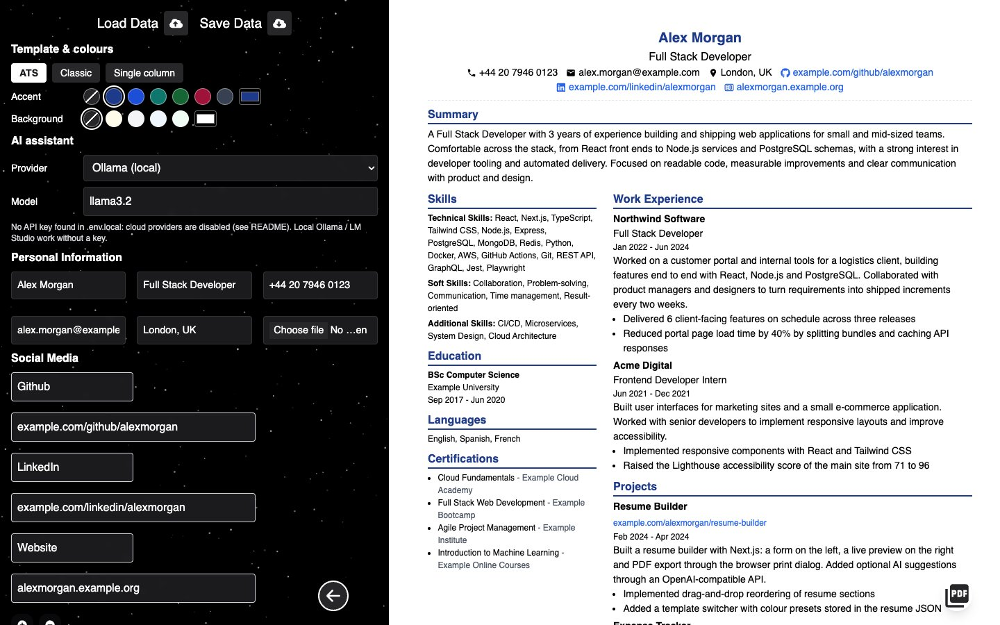
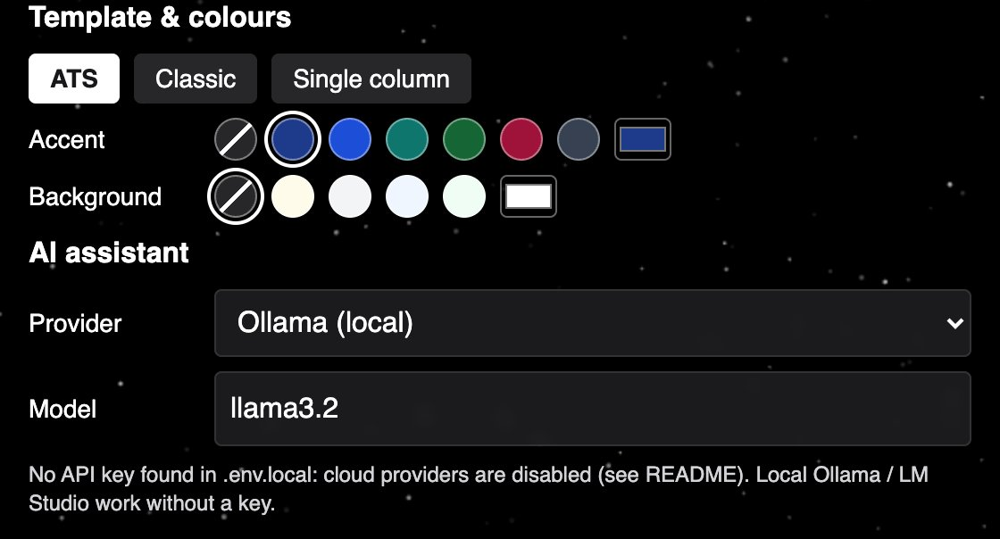
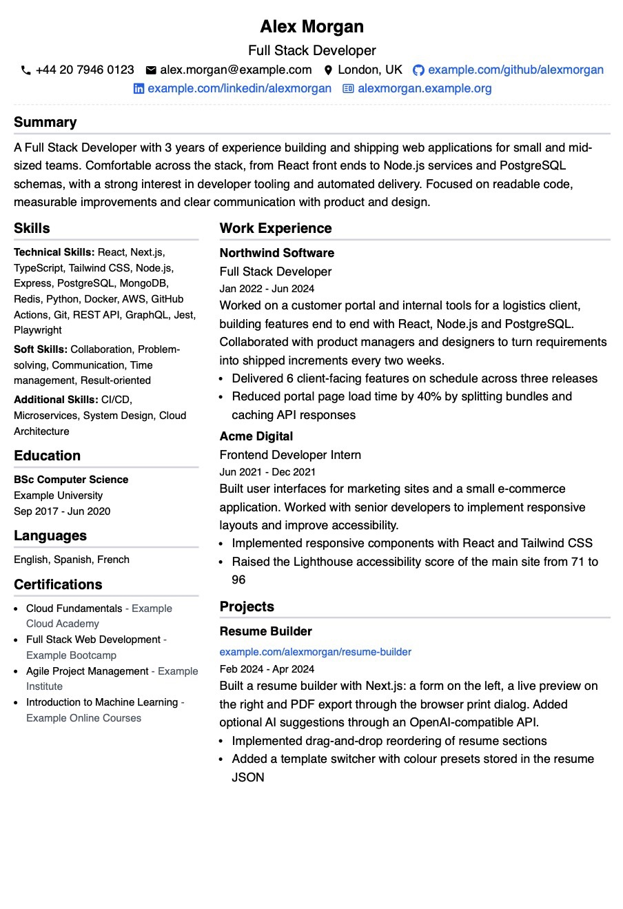
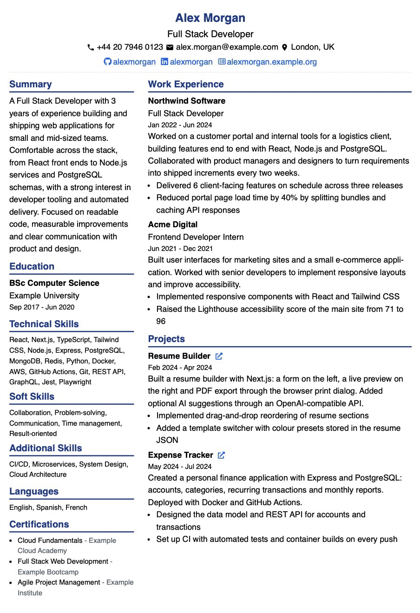
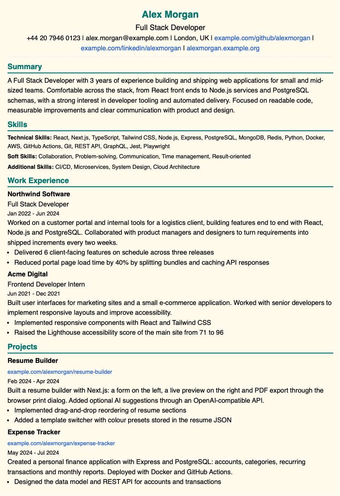

# Free Resume Maker: ATS-friendly resume builder with AI suggestions

Free, open-source resume (CV) builder that runs locally. Fill in a form, watch the live preview and export a text-based PDF that applicant tracking systems (ATS) and AI resume checkers can parse. AI suggestions for every text field work with OpenAI, Anthropic Claude, Google Gemini, OpenRouter, Groq, DeepSeek, Mistral, local Ollama / LM Studio or any OpenAI-compatible API. No account, no tracking: the resume is kept in a JSON file you save yourself.



## Key features

- **ATS template by default**: two columns, static layout, PDF text in reading order; dates printed as "Oct 2018 - Sep 2022", "Present" when the end date is empty
- **Template & colours**: switch between *ATS*, *Classic* (drag-and-drop entries, editable headings) and *Single column* (the ATS layout in one column); pick an accent colour (name, section headings, underlines) and a page background from presets or any custom colour. The choice is stored in the resume JSON (`theme`), so Save/Load Data keeps it
- **AI suggestions** for text fields with the provider and model of your choice (OpenAI, OpenRouter, Anthropic, Gemini, Groq, DeepSeek, Mistral, local Ollama / LM Studio, or any OpenAI-compatible server); provider and model are remembered by the browser
- **Live preview** while you type; Enter in a field never reloads the page
- **Save / Load Data**: the whole resume as a JSON file
- **Drag & drop** entries in the Classic template
- **Export to PDF** with the browser print dialog
- **Run as a Mac app**: production build served by a launchd agent on port 3030 and a Dock icon via Safari or Chrome (see below)

## Screenshots

Template, colours and AI provider are chosen in the form:



Sample resume (fictional) in the three templates; *Classic* with the Navy accent, *Single column* with the Teal accent and Cream background:

| ATS | Classic | Single column |
|---|---|---|
|  |  |  |

## Why the PDF is ATS-friendly

ATS and AI resume checkers read the text layer of the PDF, not the picture. The builder is set up so that this text is clean:

- **Real text, not images**: the PDF comes from the browser print dialog, so every word can be selected, copied and searched
- **Reading order**: in the *ATS* template the extracted text comes out as name, contacts, summary, then the left column and the right column, each section in one piece; the layout is static (no drag-and-drop), so the order is predictable; in the *Single column* template the sections follow one another top to bottom: Summary, Skills, Work Experience, Projects, Education, Certifications, Languages
- **Standard section headings**: Summary, Work Experience, Education, Projects, Skills, Languages, Certifications
- **One date format**: "Oct 2018 - Sep 2022", "Present" for a current role
- **Plain contacts**: phone, email, location and links are text, not icons only

Check your own file: open the PDF, select all, copy and paste into a plain-text editor. If the text reads in the right order, an ATS will read it too. Disable headers and footers in the print dialog, otherwise the date and URL end up in the text.

## Built with

- Next.js (pages router), React, Tailwind CSS
- OpenAI-compatible chat API for suggestions (provider and model selectable in the app)
- React Beautiful DnD, React Icons

## Getting started (development)

Requires Node.js 18 or later.

1. Clone the repository and go to the project directory:
```bash
git clone https://github.com/Arcry/ats-resume-builder.git
cd ats-resume-builder
```

2. Install dependencies:
```bash
npm install
```

3. Set up AI providers (optional): copy `.env.example` to `.env.local` and fill in the keys for the providers you want to use, for example:
```bash
OPENROUTER_API_KEY=your_api_key_here
```
See [AI providers](#ai-providers) below.

4. Start the development server from the project directory (Tailwind needs the working directory to be the project root):
```bash
npm run dev
```

5. Open `http://127.0.0.1:3000` and click **Create Resume** (or go straight to `http://127.0.0.1:3000/builder`). The server listens on `127.0.0.1` only, so the API that uses your keys is not reachable from the local network.

## Usage tips

1. **Template & colours**: the block under Load/Save Data switches the template and sets the accent and background colours. The crossed-out swatch means "default" (black headings, white page)
2. **AI suggestions**: pick a provider and model in the "AI assistant" block, then click the lightbulb icon next to a field to get two improved versions. Errors (missing key, unknown model, quota) are shown in the same panel
3. **Profile section**: start with your personal information and professional summary
4. **Experience & projects**: use action verbs and quantify achievements
5. **Skills & certifications**: include relevant technical and soft skills
6. **Project links**: add repository or live links to showcase your work
7. **Save / Load Data**: save the JSON regularly; it is the only place the resume is stored
8. **Download**: before printing to PDF, disable headers and footers in the browser print settings

## AI providers

Suggestions are requested through the OpenAI-compatible `chat/completions` endpoint of the selected provider. Keys live in `.env.local` on the server; the provider and model are chosen in the app ("AI assistant" block) and remembered by the browser, not in the resume JSON.

| Preset | Key in `.env.local` | Base URL | Default model |
|---|---|---|---|
| OpenAI | `OPENAI_API_KEY` | `https://api.openai.com/v1` | `gpt-6-luna` |
| OpenRouter | `OPENROUTER_API_KEY` | `https://openrouter.ai/api/v1` | `openai/gpt-6-luna` |
| Anthropic | `ANTHROPIC_API_KEY` | `https://api.anthropic.com/v1` | `claude-sonnet-5-5` |
| Google Gemini | `GEMINI_API_KEY` | `https://generativelanguage.googleapis.com/v1beta/openai` | `gemini-3.7-flash` |
| Groq | `GROQ_API_KEY` | `https://api.groq.com/openai/v1` | `llama-3.3-70b-versatile` |
| DeepSeek | `DEEPSEEK_API_KEY` | `https://api.deepseek.com` | `deepseek-flash` |
| Mistral | `MISTRAL_API_KEY` | `https://api.mistral.ai/v1` | `mistral-small-latest` |
| Ollama (local) | — | `http://localhost:11434/v1` | type the name from `ollama list` |
| LM Studio (local) | — | `http://localhost:1234/v1` | type the loaded model name |
| Custom | `AI_CUSTOM_API_KEY` (optional) | entered in the app (usually ends with `/v1`) | type the model name |

Notes:

- The request contains only `model` and `messages` (no `temperature`, `top_p` or `max_tokens`) so that the same call works across providers.
- Anthropic documents its OpenAI-compatible endpoint as intended for testing and comparing models, not as a production solution. API keys that are not bound to a workspace additionally require an `anthropic-workspace-id` header, which this app does not send: use a workspace-bound key.
- Gemini reports authentication errors as HTTP 400, not 401.
- Ollama / LM Studio: the model must already be pulled or loaded.
- `GET /api/ai-config` only reports which keys are set; key values never leave the server. Providers without a key are shown in the list but cannot be selected.
- The dev server picks up newly added keys on the fly, but keeps values it has already loaded: after changing or removing a key, restart `npm run dev` and reload the page. The production service (below) reads `.env.local` once at start: run `npm run app:restart` after any change.

## Run as a Mac app

The production build is served by a launchd user agent on `http://127.0.0.1:3030`; it starts at login and is restarted automatically if it exits. The Dock icon is a Safari or Chrome web app pointing at the builder. The development server on port 3000 is not affected: production builds go to `.next-prod`, the dev server keeps using `.next`.

### First-time setup

From the project directory:

```bash
npm run build:prod     # next build into .next-prod
npm run app:install    # fill in the plist template, put it into ~/Library/LaunchAgents and start the agent
```

Then add the Dock icon:

- **Safari** (macOS 14 or later): open `http://127.0.0.1:3030/builder` and choose **File → Add to Dock**. Safari uses the page icon (`/assets/logo.png`) and title; the name can be changed in the dialog. The web app opens in its own window without browser toolbars; printing works as in Safari.
- **Chrome**: open the same address, then **⋮ → Save and share → Create shortcut…**, tick **Open as window**. The app appears in `~/Applications/Chrome Apps`; right-click its Dock icon → **Options → Keep in Dock**. It works only while Chrome is running.

### Day to day

| What changed | What to run |
|---|---|
| Code or templates | `npm run build:prod && npm run app:restart` |
| Keys in `.env.local` | `npm run app:restart` |
| Nothing, the app just does not answer | `npm run app:status`, then `npm run app:logs` |

- `npm run app:status` prints the launchd state (`state = running`) and the PID.
- `npm run app:logs` shows the last 50 lines of `~/Library/Logs/free-resume-maker/stdout.log` and `stderr.log`.
- `npm run start:prod` runs the same production server in the foreground, without the agent: use it to run the app once (stop with Ctrl+C). If the agent is installed, remove it first, since both use port 3030.

### Remove

```bash
npm run app:uninstall   # launchctl bootout + delete the plist; logs and .next-prod are kept
```

### How it works

- `scripts/launchd/local.free-resume-maker.plist` is a template: `npm run app:install` fills in the absolute paths of `node` (from your `PATH`), the project directory and the log directory, because launchd does not read the shell `PATH`. The agent runs `node node_modules/next/dist/bin/next start -H 127.0.0.1 -p 3030` in the project directory with `NEXT_DIST_DIR=.next-prod` and `NODE_ENV=production`. If the project or Node moves, run `npm run app:install` again.
- `next.config.mjs` sets `distDir` from `NEXT_DIST_DIR` (default `.next`).
- `KeepAlive` restarts the server after a crash; `RunAtLoad` starts it at login. If there is no build in `.next-prod`, the server exits and launchd retries every 10 seconds — run `npm run build:prod`.

## Important note

When printing to PDF, disable headers and footers in the browser print settings for the best results.

## License

Apache-2.0, see [LICENSE](LICENSE). Fork of [free-resume-maker](https://github.com/HOTHEAD01TH/free-resume-maker) (Apache-2.0), modified: templates and colours, multiple AI providers, a fictional sample resume, the Mac app setup and other changes. The full list of changes is in the git history.
